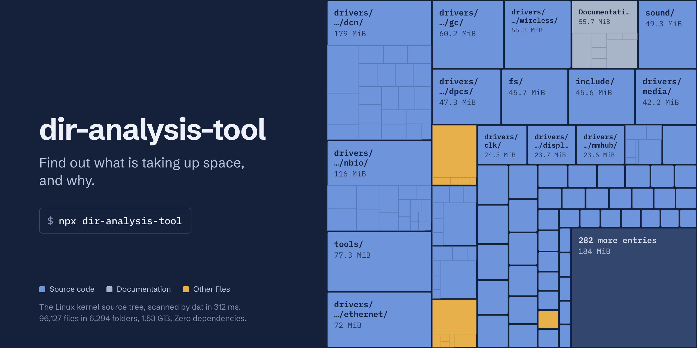

<div align="center">

<a href="https://www.npmjs.com/package/dir-analysis-tool">
  
</a>

<h1>dir-analysis-tool</h1>

<p><strong>Find out what is taking up space, fast.</strong> Largest folders and files, type and extension breakdowns, duplicate detection, size budgets for CI, directory diffs, and self-contained reports.</p>

<p>
  <a href="https://www.npmjs.com/package/dir-analysis-tool"></a>
  <a href="https://www.npmjs.com/package/dir-analysis-tool"></a>
  <a href="https://github.com/KhaledSaeed18/dir-analysis-tool/actions/workflows/ci.yml"></a>
  <a href="https://www.npmjs.com/package/dir-analysis-tool"></a>
  <a href="LICENSE"></a>
</p>

<p>
  <a href="https://github.com/KhaledSaeed18/dir-analysis-tool/stargazers"></a>
  <a href="https://github.com/KhaledSaeed18/dir-analysis-tool/issues"></a>
  <a href="https://github.com/KhaledSaeed18/dir-analysis-tool/releases"></a>
</p>

</div>

---

```bash
npx dir-analysis-tool
```

## Why dir-analysis-tool?

- **Fast.** A concurrent, bounded scanner `stat`s every file exactly once. On a 140,000-file tree it is about 3× faster than v2, and duplicate detection is about 4× faster.
- **Light.** Memory stays flat while scanning (about 9 MB retained for 140,000 files), and the package has just three direct dependencies.
- **Answers the real question.** _Which folders and files take the space?_ Then types, extensions, duplicates, stale files, and empty ones.
- **Correct.** Hard-linked data is counted once, symlinks can be followed without looping, unreadable paths are reported instead of silently skipped, and output is deterministic.
- **Built for CI.** Size budgets fail the build with exit code 2, Markdown output drops straight into a pull request or job summary, and `--json` stays clean when piped.
- **Shareable.** A single-file HTML report that works offline, plus CSV export.
- **A library too.** Every feature is available as a typed API.

## Contents

- [Installation](#installation)
- [Quick start](#quick-start)
- [What it shows](#what-it-shows)
- [Commands](#commands): [`analyze`](#dat-analyze), [`compare`](#dat-compare), [`watch`](#dat-watch), [`init`](#dat-init)
- [Sizes, ages, and patterns](#sizes-ages-and-patterns)
- [Budgets in CI](#budgets-in-ci)
- [Output formats](#output-formats)
- [Configuration](#configuration)
- [Library API](#library-api)
- [How it works](#how-it-works)
- [Exit codes](#exit-codes)
- [Migrating from v2](#migrating-from-v2)
- [FAQ](#faq)

## Installation

Requires Node.js 22.12 or later.

```bash
npm install -g dir-analysis-tool    # or: pnpm add -g dir-analysis-tool
```

Two equivalent commands are installed: `dat` (short) and `dir-analysis-tool`. To run without installing:

```bash
npx dir-analysis-tool ~/Downloads
```

To use it from code:

```bash
npm install dir-analysis-tool
```

## Quick start

```bash
dat                                   # analyze the current directory
dat ~/Downloads -l 500MB              # files of 500 MB or more
dat . -d                              # duplicate files and reclaimable space
dat . --stale 2y                      # files untouched for two years
dat . -t --tree-depth 2               # a size tree, two levels deep
dat . -g -x                           # honor .gitignore, show extensions
dat compare dist-old dist-new         # what changed between two builds
dat . -b "size<=200MB" -b "duplicates=0"   # fail CI when a budget is exceeded
dat . --html report.html              # a self-contained HTML report
dat . --json | jq '.largestFiles[0]'  # machine-readable output
```

## What it shows

`dat . -g -d` on this repository:

```text
 dat  ~/code/dir-analysis-tool  5ms

   Size      1.4 MiB  (1.58 MiB on disk)
   Files     83
   Folders   19
   Skipped   22 excluded

 File types
   Images     ██████████▌         937 KiB   65%  1 file
   Code       █████▏              458 KiB   32%  71 files
   Documents  ▌                  39.3 KiB    3%  8 files
   Other                            113 B   <1%  3 files

 Largest folders
      937 KiB  .github/assets/  1 file
      212 KiB  src/  38 files
     78.7 KiB  src/core/  11 files
     74.7 KiB  test/  14 files
     51.1 KiB  src/cli/  12 files

 Largest files
      937 KiB  .github/assets/dir-analysis-tool-banner.png
      147 KiB  pnpm-lock.yaml
     20.8 KiB  src/core/analyze.ts
     18.1 KiB  test/integration/analyze.test.ts
     17.2 KiB  src/reporters/html.ts

 Duplicates  none found
```

Colors are used in interactive terminals and turned off when output is piped, when `NO_COLOR` is set, or with `--no-color`.

A size tree (`dat src -t --tree-depth 2`):

```text
 Tree
      212 KiB  .
     78.7 KiB  ├─ core/
     20.8 KiB  │  ├─ analyze.ts
     13.9 KiB  │  ├─ scanner.ts
       10 KiB  │  ├─ compare.ts
        535 B  │  └─ … 1 more entry
     51.1 KiB  ├─ cli/
     23.1 KiB  │  ├─ commands/
     13.5 KiB  │  ├─ options.ts
          …
```

## Commands

### `dat analyze`

`dat [directory] [options]`. `analyze` is the default command, so `dat .` and `dat analyze .` are the same.

**Scan options** decide which files are counted. They also apply to `compare` and `watch`.

| Option                                       | Description                                                                                                       |
| -------------------------------------------- | ----------------------------------------------------------------------------------------------------------------- |
| `-e, --exclude <pattern>`                    | Skip paths matching a gitignore-style pattern. Repeatable: `-e '*.log' -e build/`.                                |
| `-a, --all`                                  | Include `.git`, `.hg`, `.svn`, and `node_modules`, which are skipped by default.                                  |
| `-g, --gitignore`                            | Honor `.gitignore` files, including those above the directory and `.git/info/exclude`.                            |
| `--max-depth <n>`                            | Descend at most `n` levels. `0` scans only the top-level files.                                                   |
| `-L, --follow-symlinks`                      | Follow symbolic links. Cycles are detected and every file is counted once.                                        |
| `--count-hardlinks`                          | Count every hard link separately. By default, shared data is counted once.                                        |
| `--min-size <size>`, `--max-size <size>`     | Only include files in a size range, such as `--min-size 1MB`.                                                     |
| `--newer-than <when>`, `--older-than <when>` | Only include files modified after or before an age (`30d`) or a date (`2024-01-31`). Dates include the whole day. |
| `-c, --config <file>`                        | Use this config file instead of discovering one.                                                                  |
| `--no-config`                                | Ignore config files.                                                                                              |

**Report options** turn reports on or off. Largest folders, largest files, and the type breakdown are always shown.

| Option                        | Description                                                                                   |
| ----------------------------- | --------------------------------------------------------------------------------------------- |
| `-n, --top <n>`               | Length of the largest folders and files lists. Default `10`; `0` hides them.                  |
| `-l, --large-files [size]`    | List files at least this large. Default `100MiB`.                                             |
| `-d, --duplicates`            | Find files with identical contents and the space they waste.                                  |
| `--min-duplicate-size <size>` | Ignore smaller files when looking for duplicates.                                             |
| `--empty`                     | List empty files and empty folders.                                                           |
| `--stale [when]`              | List files not modified since an age or date. Default `1y`.                                   |
| `-x, --extensions`            | Show the breakdown by file extension.                                                         |
| `--no-types`                  | Hide the breakdown by file type.                                                              |
| `-t, --tree`                  | Show a size tree.                                                                             |
| `--tree-depth <n>`            | Levels shown by `--tree`. Default `3`.                                                        |
| `-b, --budget <rule>`         | Fail with exit code 2 unless the rule holds. Repeatable. See [Budgets in CI](#budgets-in-ci). |

**Output options:**

| Option                  | Description                                                                          |
| ----------------------- | ------------------------------------------------------------------------------------ |
| `-f, --format <format>` | `pretty` (default), `json`, `markdown`, `csv`, or `html`.                            |
| `-j, --json`            | Same as `--format json`.                                                             |
| `-o, --output <file>`   | Write the report to a file instead of stdout.                                        |
| `--html [file.html]`    | Also write an HTML report. Default name `directory-analysis-<date>.html`.            |
| `--csv [file.csv]`      | Also write a CSV export. Default name `directory-analysis.csv`.                      |
| `--si`                  | Decimal units (kB, MB, powers of 1000) instead of binary (KiB, MiB, powers of 1024). |
| `--color`, `--no-color` | Force colors on or off. `NO_COLOR` and `FORCE_COLOR` are honored.                    |
| `--no-progress`         | Hide the progress line. It is only ever drawn on an interactive stderr.              |
| `-q, --quiet`           | Print only the report and errors.                                                    |

### `dat compare`

`dat compare <left> <right> [options]` shows what changed between two directories: files added, removed, and changed, size changes per type, and the folders that changed most. Both sides use the same scan options.

```text
 dat compare  2ms

   left   ~/build/before
   right  ~/build/after

 Overview
                     left       right  change
   Size           164 KiB     189 KiB  +24.6 KiB (+15.0%)
   On disk        172 KiB     200 KiB  +28 KiB
   Files                4           4  ±0
   Folders              0           0  ±0

 Added  1 file · 39.1 KiB
   +   39.1 KiB  chunk-new.js

 Removed  1 file · 18.8 KiB
   -   18.8 KiB  index.d.ts

 Changed  1 file · +4.39 KiB net
   ~  +4.39 KiB  cli.js  35.9 KiB → 40.3 KiB

 2 files unchanged (compared by size)
```

| Option                  | Description                                                                                 |
| ----------------------- | ------------------------------------------------------------------------------------------- |
| `--content`             | Also compare same-sized files by content (SHA-256). By default, files are compared by size. |
| `-n, --top <n>`         | Items per list. Default `10`.                                                               |
| `-f, --format <format>` | `pretty`, `json`, `markdown`, or `csv`.                                                     |

All scan and output options above are accepted too.

### `dat watch`

`dat watch [directory] [options]` re-analyzes whenever something changes. It uses the operating system's native file watching: recursive on macOS and Windows; on Linux, one watcher per scanned folder, so skipped folders like `node_modules` are never watched. If watching fails, it falls back to polling.

```bash
dat watch . -l 1GB                        # keep an eye on large files
dat watch . --json | jq -c .summary       # one JSON document per line (NDJSON)
```

| Option             | Description                                                |
| ------------------ | ---------------------------------------------------------- |
| `--debounce <ms>`  | Wait this long after the last change. Default `300`.       |
| `--poll <seconds>` | Re-scan on an interval instead of using filesystem events. |
| `--no-clear`       | Keep earlier reports instead of clearing the screen.       |

All scan, report, and output options are accepted too (`pretty` and `json` formats).

### `dat init`

`dat init [directory]` asks a few questions and writes a `.dir-analyzer.json`. Use `--yes` to write a starter file without questions, and `--force` to overwrite an existing one.

## Sizes, ages, and patterns

**Sizes** are bytes or a number with a unit, case-insensitive:

| Input                  | Meaning                                               |
| ---------------------- | ----------------------------------------------------- |
| `4096`                 | 4,096 bytes                                           |
| `10k`, `10KiB`         | 10 × 1,024 bytes                                      |
| `1.5M`, `1.5MiB`       | 1.5 × 1,024² bytes                                    |
| `10kB`, `500MB`, `1GB` | Decimal: 10,000, 500,000,000, and 1,000,000,000 bytes |

**Ages and dates:** an age counts back from now (`45s`, `30min`, `12h`, `90d`, `2w`, `6mo`, `1y`). A date is `YYYY-MM-DD` in local time, or any ISO 8601 timestamp.

**Patterns** use [gitignore syntax](https://git-scm.com/docs/gitignore#_pattern_format) relative to the analyzed directory: `*.log` matches at any depth, `build/` matches only directories, `/out` matches only at the top, `docs/**/*.pdf` matches nested files, and `!keep.log` re-includes a file.

## Budgets in CI

A budget is a rule that must hold. When any budget fails, `dat` exits with code 2 and says which one failed, so the CI step fails.

```bash
dat dist -b "size<=2MB" -b "largest<500kB" -b "files<200"
dat . -g -b "duplicates=0" -b "wasted<1MB"
```

Rules are `<metric><operator><value>`, with operators `<`, `<=`, `>`, `>=`, `=`, and `!=`.

| Metric                 | Meaning                                                              |
| ---------------------- | -------------------------------------------------------------------- |
| `size`, `disk`         | Total apparent size, total size on disk                              |
| `files`, `dirs`        | Number of files, number of folders                                   |
| `largest`              | Size of the largest file                                             |
| `large`                | Number of large files (turns on `--large-files`)                     |
| `duplicates`, `wasted` | Duplicate groups, and the space they waste (turns on `--duplicates`) |
| `empty`                | Number of empty files (turns on `--empty`)                           |
| `stale`                | Number of stale files (turns on `--stale`)                           |
| `errors`               | Number of unreadable paths                                           |

A GitHub Actions step that posts a report to the job summary and enforces a budget:

```yaml
- name: Check the bundle size
  run: npx dir-analysis-tool@3 dist -b "size<=2MB" -f markdown >> "$GITHUB_STEP_SUMMARY"
```

## Output formats

| Format     | Use it for                                                                                                                                                      |
| ---------- | --------------------------------------------------------------------------------------------------------------------------------------------------------------- |
| `pretty`   | Reading in a terminal.                                                                                                                                          |
| `json`     | Scripts and tools. The library returns exactly this shape.                                                                                                      |
| `markdown` | Pull request comments and CI job summaries (GitHub-flavored tables).                                                                                            |
| `csv`      | Spreadsheets. One row per item, with a `section` column. UTF-8 with BOM. Cells that could run as formulas are neutralized.                                      |
| `html`     | Sharing. One self-contained file with inline SVG charts, light and dark themes, a path filter, and a Content-Security-Policy that blocks every network request. |

Only the report goes to stdout. Progress, warnings, and status messages go to stderr, so `dat . --json > out.json` and pipes always get clean data.

JSON is versioned (`"schemaVersion": 3`). Sizes are raw bytes, dates are ISO 8601, and paths are relative to `root` with `/` separators on every platform. The [types](src/types.ts) document every field. In short:

```jsonc
{
  "schemaVersion": 3,
  "tool": { "name": "dir-analysis-tool", "version": "3.0.0" },
  "root": "/home/me/project",
  "durationMs": 42,
  "summary": {
    "bytes": 1468006,
    "diskBytes": 1656832,
    "files": 83,
    "directories": 19,
    "largestFileBytes": 959488,
    "symlinks": 0,
    "hardlinks": 0,
    "excluded": 22,
    "filtered": 0,
    "errors": 0,
  },
  "types": {
    "code": { "files": 71, "bytes": 469000 },
    "images": { "files": 1, "bytes": 959488 } /* every category */,
  },
  "extensions": [{ "extension": ".png", "files": 1, "bytes": 959488 }],
  "largestDirectories": [{ "path": ".github/assets", "bytes": 959488, "files": 1 }],
  "largestFiles": [
    {
      "path": ".github/assets/banner.png",
      "bytes": 959488,
      "modified": "2026-07-03T17:40:00.000Z",
    },
  ],
  "duplicates": { "count": 0, "files": 0, "bytes": 0, "wastedBytes": 0, "items": [] }, // with --duplicates
  "errors": [],
}
```

Optional sections appear only when their report is on: `largeFiles`, `duplicates`, `emptyFiles`, `emptyDirectories`, `staleFiles`, `tree`, and `budgets`.

## Configuration

Settings can live in `.dir-analyzer.json` (or `dir-analyzer.config.json`). `dat` looks for one in the analyzed directory and then in each parent. `watch` does the same; `compare` searches from the current directory. **Command-line flags always win.** Exclude patterns and budgets from the file and from flags are combined.

```json
{
  "$schema": "https://unpkg.com/dir-analysis-tool@3/schema.json",
  "exclude": ["coverage/", "*.log"],
  "gitignore": true,
  "top": 15,
  "largeFiles": "50MB",
  "duplicates": true,
  "budgets": ["size<=500MB", "duplicates=0"]
}
```

The `$schema` line gives you autocompletion and validation in most editors. Every key:

| Key                      | Type                    | Default   | Flag                           |
| ------------------------ | ----------------------- | --------- | ------------------------------ |
| `exclude`                | `string[]`              | `[]`      | `--exclude`                    |
| `defaultExcludes`        | `boolean`               | `true`    | `--all` sets it to `false`     |
| `gitignore`              | `boolean`               | `false`   | `--gitignore`                  |
| `maxDepth`               | `integer`               | unlimited | `--max-depth`                  |
| `followSymlinks`         | `boolean`               | `false`   | `--follow-symlinks`            |
| `countHardlinks`         | `boolean`               | `false`   | `--count-hardlinks`            |
| `minSize`, `maxSize`     | size                    | none      | `--min-size`, `--max-size`     |
| `newerThan`, `olderThan` | age or date             | none      | `--newer-than`, `--older-than` |
| `top`                    | `integer`               | `10`      | `--top`                        |
| `largeFiles`             | size or `boolean`       | off       | `--large-files`                |
| `duplicates`             | `boolean`               | `false`   | `--duplicates`                 |
| `minDuplicateSize`       | size                    | `1`       | `--min-duplicate-size`         |
| `empty`                  | `boolean`               | `false`   | `--empty`                      |
| `stale`                  | age, date, or `boolean` | off       | `--stale`                      |
| `extensions`             | `boolean`               | `false`   | `--extensions`                 |
| `tree`, `treeDepth`      | `boolean`, `integer`    | off, `3`  | `--tree`, `--tree-depth`       |
| `units`                  | `"iec"` or `"si"`       | `"iec"`   | `--si`                         |
| `budgets`                | `string[]`              | `[]`      | `--budget`                     |

Invalid values stop the run with a precise message. Unknown keys produce a warning. Config files from v1 and v2 still work: their keys are translated, with a deprecation warning.

## Library API

Everything the CLI does is available from code. Results are plain JSON-serializable objects. The package ships ESM with full TypeScript types.

```ts
import { analyze, compare, formatBytes, renderAnalysisMarkdown } from 'dir-analysis-tool';

const result = await analyze('./dist', {
  exclude: ['*.map'],
  duplicates: true,
  budgets: ['size<=2MB'],
});

console.log(formatBytes(result.summary.bytes)); // "1.4 MiB"
console.log(result.largestFiles[0]?.path);
console.log(result.budgets?.every((b) => b.passed));

const diff = await compare('./dist-main', './dist', { content: true });
console.log(diff.added.count, diff.changed.count, formatBytes(diff.delta.bytes));

await writeFile('report.md', renderAnalysisMarkdown(result));
```

| Export                                                                                | Purpose                                                                                                                                                                                                                                |
| ------------------------------------------------------------------------------------- | -------------------------------------------------------------------------------------------------------------------------------------------------------------------------------------------------------------------------------------- |
| `analyze(path, options?)`                                                             | Analyze a tree. Options mirror the CLI flags: `exclude`, `gitignore`, `maxDepth`, `minSize`, `modifiedAfter`, `top`, `largeFiles`, `duplicates`, `empty`, `stale`, `tree`, `budgets`, `concurrency`, `signal`, `onProgress`, and more. |
| `compare(left, right, options?)`                                                      | Diff two trees.                                                                                                                                                                                                                        |
| `listDirectories(path, options?)`                                                     | The folders a scan would enter.                                                                                                                                                                                                        |
| `renderAnalysis`, `renderAnalysisMarkdown`, `renderAnalysisCsv`, `renderAnalysisHtml` | Render a result in any format. `renderComparison*` does the same for comparisons.                                                                                                                                                      |
| `formatBytes`, `parseSize`, `parseDuration`, `parsePointInTime`                       | Unit helpers.                                                                                                                                                                                                                          |
| `loadConfig`, `validateConfig`, `buildJsonSchema`                                     | Config helpers.                                                                                                                                                                                                                        |
| `parseBudget`, `evaluateBudgets`                                                      | Budget helpers.                                                                                                                                                                                                                        |
| `DatError`, `AbortError`                                                              | Expected failures, and cancellation through `signal`.                                                                                                                                                                                  |

Sizes and times accept the same strings as the CLI (`minSize: '10MB'`, `modifiedAfter: '30d'`), as well as numbers and `Date`s.

## How it works

- **Scanning.** Directories are read with `readdir({ withFileTypes })`, so they never need a `stat`, and each regular file is `lstat`ed once. All filesystem calls go through one concurrency limiter, so no tree, however wide, can exhaust file handles. Work is scheduled depth-first to keep the queue small.
- **Memory.** Totals, type and extension statistics, folder sizes, and the top-N lists are computed while scanning; the lists use bounded heaps. Reports you opt into keep only what they match. Duplicate detection keeps one small record per file that shares its size with another.
- **Largest folders.** Folders are ranked by the total size below them. A folder whose size comes almost entirely (95% or more) from one subfolder is folded into that subfolder, so the list points to where the data actually lives instead of repeating every parent.
- **Duplicates,** in stages so most files are never read in full:
  1. Only sizes shared by at least two files are considered. Empty files are excluded, and hard links to the same data are not copies.
  2. Files over 256 KiB are compared by a SHA-256 sample of their first and last 64 KiB.
  3. Remaining candidates are hashed in full with streaming SHA-256 and reusable buffers.
- **Disk usage.** Sizes are apparent sizes (file lengths). `On disk` is the space allocated in blocks, which is what `du` reports.
- **Determinism.** Results are sorted by size and then by path, so the same tree always produces the same output, whatever order the filesystem returned it in.

**Benchmarks** (Apple M4, warm cache, 140,237 files, 2.97 GB):

| Task                     | v2.0.7 |         v3 |
| ------------------------ | -----: | ---------: |
| Scan                     | 1.74 s | **0.61 s** |
| Scan and find duplicates | 12.3 s |  **2.9 s** |

Both versions found the same files, bytes, and duplicate groups. Run `pnpm bench` (or `pnpm bench <directory>`) to measure on your machine.

## Exit codes

| Code  | Meaning                                                       |
| ----- | ------------------------------------------------------------- |
| `0`   | Success                                                       |
| `1`   | Error: invalid option or config, missing directory, and so on |
| `2`   | A budget failed                                               |
| `130` | Interrupted (Ctrl+C)                                          |

## Migrating from v2

v3 is a rewrite with a new output format. Most commands keep working unchanged.

| v2                                                                          | v3                                                                                              |
| --------------------------------------------------------------------------- | ----------------------------------------------------------------------------------------------- |
| Node.js 18 or 20                                                            | Node.js 22.12 or later                                                                          |
| `--json` output with `totalSizeBytes`, `totalSizeFormatted`, absolute paths | `schemaVersion: 3` with `summary.bytes`, root-relative paths, and no preformatted strings       |
| `-e a b c`                                                                  | `-e a -e b -e c`. One pattern per flag, so the directory argument is never swallowed.           |
| `--empty-files`                                                             | `--empty` (also lists empty folders). The old name still works.                                 |
| `--date-from`, `--date-to`                                                  | `--newer-than`, `--older-than`, which also accept ages such as `30d`. The old names still work. |
| `--top-n`                                                                   | `-n, --top`. The old name still works.                                                          |
| `--large-files 100` meant 100 MB                                            | Still read as 100 MiB, with a hint to add a unit; any size such as `--large-files 1.5GB` works. |
| `--csv-large`, `--csv-duplicates`                                           | `--csv`, which exports every section with a `section` column                                    |
| `dist/`, `build/`, `.cache/` excluded by default                            | Only `.git`, `.hg`, `.svn`, and `node_modules` are; use `--gitignore` or `-e` for more          |
| Sizes in decimal units (`MB`)                                               | Binary units by default (`MiB`); `--si` switches to decimal                                     |
| Config keys `excludePatterns`, `topN`, `largeSizeThresholdMB`, …            | `exclude`, `top`, `largeFiles`, …, read with a deprecation warning                              |

## FAQ

**Why does the total differ from `du`?** `du` reports blocks allocated on disk, while the headline size is the sum of file lengths. The `On disk` line matches `du`. Also check what was skipped: `.git` and `node_modules` are excluded by default (`--all` includes them), and hard-linked data is counted once, as `du` does.

**Is it safe to run on a huge directory?** Yes. Memory does not grow with the number of files unless you ask for a report that lists them, filesystem concurrency is bounded, and unreadable paths are reported rather than fatal. Press Ctrl+C at any time.

**Does it modify anything?** No. `dat` only reads, except for report files you ask it to write.

## Contributing

Bug reports and pull requests are welcome. See [CONTRIBUTING.md](CONTRIBUTING.md) for the development setup, and run `pnpm check` before opening a pull request.

## License

[MIT](LICENSE), by [Khaled Saeed](https://github.com/KhaledSaeed18).
